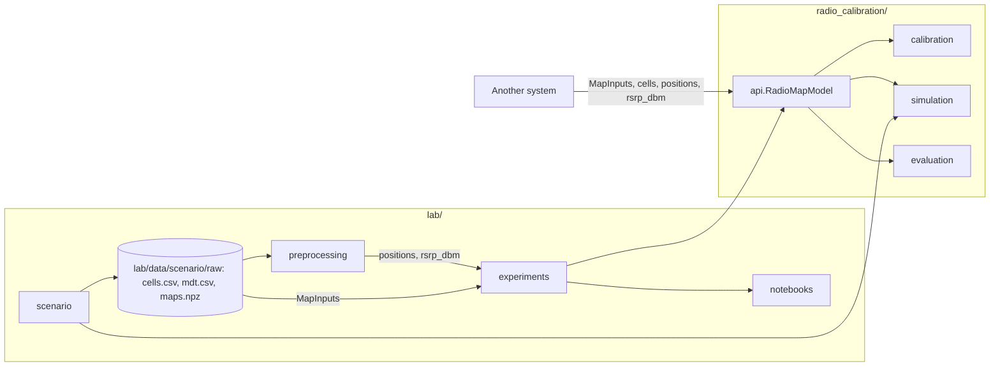
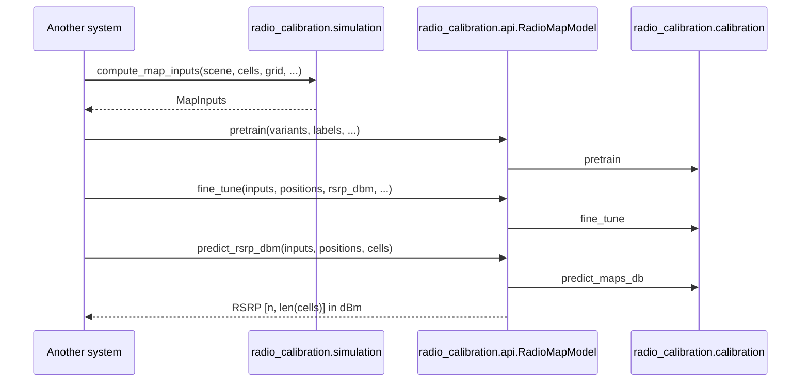

# radio-calibration

A research project that corrects Sionna RT radio maps with a U-Net and MDT measurements.
The package `radio_calibration` can go into another Python system. The directory `lab/` holds
the experiments that use it.

## Contents

- [Overview](#overview)
- [Architecture](#architecture)
- [Getting started](#getting-started)
- [Configuration](#configuration)
- [Scenarios](#scenarios)
- [Usage](#usage)
- [Development](#development)
- [Testing](#testing)
- [Related work](#related-work)
- [License](#license)
- [Acknowledgements](#acknowledgements)

## Overview

A radio map gives the path gain at each cell of a grid around a transmitter.
[Sionna RT](https://nvlabs.github.io/sionna/rt/) computes radio maps with a ray tracer.
The result depends on the 3D map of the buildings, the materials, and the antenna patterns.
A real 3D map has errors: a building is at a different position, has a different height, or
does not exist. Thus a simulated radio map differs from the measured signal.

This project corrects the simulated radio map with a U-Net. The method follows Geo2SigMap
(Li et al., [arXiv:2312.14303](https://arxiv.org/abs/2312.14303)). The path gain map of the
Sionna RT `RadioMapSolver` replaces the first U-Net of Geo2SigMap (U-Net-Iso). The U-Net gets
the simulated path gain and the geometry of the scene, and it gives the corrected path gain in
dB. It learns in two stages:

1. **Pretraining** on simulated variants of the scene. Each variant changes the buildings at
   random and places the sites at random. The target is the path gain map of the changed
   scene, and the input comes from the original scene.
2. **Fine-tuning** of all parameters on the MDT (minimization of drive tests) records.

The loss is the mean absolute error (MAE) in dB.

### Capabilities

- A locked Python environment with Sionna RT, Mitsuba, Dr.Jit, and PyTorch (CUDA 13.4).
- The package `radio_calibration`. Another system can import it to pretrain, fine-tune, save,
  and load a model, and to predict path gain maps and RSRP. See
  [Use from another system](#use-from-another-system).
- Sionna RT functions that load a scene, calculate path gain maps, measure the building heights,
  and find the line of sight on a grid.
- A scenario generator. It puts 3 sites with 3 cells each in a Sionna RT scene, changes the
  buildings at random to make a true world, and writes synthetic MDT records and the maps of
  the model. See [Scenario data](#scenario-data).
- Five scenarios. Each scenario shows one capability of the model. See [Scenarios](#scenarios).
- Three baselines in the evaluation: Sionna RT, Sionna RT with an offset, and a model with the
  form of the Standard Propagation Model of the Atoll planning tool, with coefficients from the
  same train records.
- Thin notebooks for each scenario. The shared steps are in `lab/experiments/`.
- Tests for each package, with Sionna RT on the CUDA backend.

### Non-goals

_Not documented yet._

## Architecture

The repository holds two Python packages in one [uv workspace](https://docs.astral.sh/uv/concepts/projects/workspaces/):

| Package | Directory | Import names | Content |
|---|---|---|---|
| `radio-calibration` | [`radio_calibration/`](radio_calibration/) | `radio_calibration` | The code that another system needs: the simulation, the U-Net, the error statistics and baselines, and the interface `radio_calibration.api`. It accepts processed data in a fixed format. |
| `lab` | [`lab/`](lab/) | `scenario`, `utils`, `preprocessing`, `experiments` | The experiments: the scenario generator, the raw file formats, the data preparation, the shared steps of the notebooks, the Hydra configuration, the notebooks, and the run scripts. |

`lab` uses `radio_calibration` in the same way as another system does. `radio_calibration`
never imports a module of `lab`. The wheel of `radio-calibration` contains only
`radio_calibration/`.



### Components

| Component | Responsibility | Location |
|---|---|---|
| Interface | `RadioMapModel`: pretrain, fine-tune, save, load, predict the path gain map and the RSRP, and give the error of each pair | [`radio_calibration/api.py`](radio_calibration/api.py) |
| Core | The `Cell` record, the grid `RadioMapGrid`, the input maps `MapInputs`, the rule from a map to the RSRP (`rsrp_from_map`), the typed settings, and the checks of the input data | [`radio_calibration/core/`](radio_calibration/core/) |
| Simulation | All Sionna RT calls: scene load, path gain maps (`compute_path_gain_map`), the input maps (`compute_map_inputs`), the height map, the outdoor test, and the line-of-sight map with geometric rays | [`radio_calibration/simulation/`](radio_calibration/simulation/) |
| Calibration | The U-Net, its input channels and normalization, the loss, the pretraining, the fine-tuning, and the model file. It uses PyTorch and has no Sionna RT import. | [`radio_calibration/calibration/`](radio_calibration/calibration/) |
| Evaluation | Error statistics against the measured RSRP and against a true map, the baselines (`fit_offset`, `SpmModel`), and the resource use of a block of code (`ResourceMonitor`). It does no ray tracing. | [`radio_calibration/evaluation/`](radio_calibration/evaluation/) |
| Preprocessing | The formats of `cells.csv`, `mdt.csv`, and `maps.npz`, the validation rules, the long format, the division into parts, and the change to the arrays of `radio_calibration` | [`lab/preprocessing/`](lab/preprocessing/) |
| Scenario | Changes of the buildings, site placement, traffic model, MDT records from the true map | [`lab/scenario/`](lab/scenario/) |
| Experiments | Shared steps of the notebooks: data of a scenario, pretraining, fine-tuning, baselines, tables, and figures | [`lab/experiments/`](lab/experiments/) |
| Utilities | Paths of a scenario, configuration and typed settings, figure style, random seeds, device selection, notebook setup, steps and archive of a run | [`lab/utils/`](lab/utils/) |
| Scripts | Runs of the pipeline or of the notebooks of one scenario, with one archive of the results | [`lab/scripts/`](lab/scripts/) |
| Configuration | Hydra configuration files | [`lab/configs/`](lab/configs/) |
| Notebooks | One directory for each scenario: scenario, EDA, preprocessing, pretraining, fine-tuning, evaluation | [`lab/notebooks/`](lab/notebooks/) |
| Tests | One test file for each package of the two packages, and the checks of the environment | [`tests/`](tests/) |

### External dependencies

| Dependency | Purpose | Package | Criticality |
|---|---|---|---|
| [Sionna RT](https://github.com/NVlabs/sionna-rt) 2.2.0 | Ray tracer that computes radio maps | `radio-calibration` | Critical |
| [Mitsuba](https://github.com/mitsuba-renderer/mitsuba3) 3.9.1 | Renderer below Sionna RT, and the geometric rays of the height map and the line-of-sight map. Sionna RT pins this version. | `radio-calibration` | Critical |
| [Dr.Jit](https://github.com/mitsuba-renderer/drjit) 1.5.0 | Just-in-time compiler below Mitsuba. Sionna RT pins this version. | `radio-calibration` | Critical |
| [PyTorch](https://pytorch.org/) 2.15.0+cu134 | The U-Net, its training, and its model file | `radio-calibration` | Critical |
| NumPy, pandas, SciPy | Arrays, tables, least squares, and the nearest-record distance | `radio-calibration` | Critical |
| [psutil](https://github.com/giampaolo/psutil) | Memory and CPU use of the process for `ResourceMonitor` | `radio-calibration` | Low |
| [nvidia-ml-py](https://pypi.org/project/nvidia-ml-py/) | NVML bindings of NVIDIA: GPU memory and GPU use for `ResourceMonitor` | `radio-calibration` | Low |
| [Hydra](https://hydra.cc/) | Experiment configuration | `lab` | Critical for `lab` |

[`uv.lock`](uv.lock) records the exact version of each package.

## Getting started

### Prerequisites

| Requirement | Version | Notes |
|---|---|---|
| Python | 3.13 | `uv` installs it from [`.python-version`](.python-version). |
| [uv](https://docs.astral.sh/uv/) | >=0.11.30, <0.12 | The build backend `uv_build` sets this range. |
| NVIDIA GPU and driver | A driver that supports CUDA 13.4 | The environment was tested on Windows 11 with driver 610.88 and an RTX 3050 Ti (4 GB). |
| [Task](https://taskfile.dev/) | 3.52 or later | Optional. It gives short names to the commands below. |

### Install

```bash
git clone https://github.com/Wombat-Engineers/radio-calibration.git
cd radio-calibration
uv sync
uv run pre-commit install
```

`uv sync` installs the two packages of the workspace, `radio-calibration` and `lab`, in
editable mode. It installs PyTorch from the PyTorch package index for CUDA 13.4.
On Windows, PyPI has only the CPU build of PyTorch.

### Run

```bash
uv run jupyter lab
```

### Verify

```bash
uv run pytest
```

The tests for Mitsuba and Sionna RT use the CUDA variant `cuda_ad_mono_polarized`.
They fail if CUDA is not available. They do not use the CPU variant.

Dr.Jit can print `jitc_llvm_init(): LLVM API initialization failed` when LLVM is not installed.
The CUDA variants operate without LLVM.

## Configuration

[Hydra](https://hydra.cc/) reads the configuration of `lab` from [`lab/configs/`](lab/configs/).
`radio_calibration` does not read a file: it gets `SimulationSettings` and
`CalibrationSettings` objects. `utils.simulation_settings` and `utils.calibration_settings`
make them from the configuration.

[`lab/configs/config.yaml`](lab/configs/config.yaml) is the root configuration. It loads the
selected scenario and each other file of `lab/configs/` into its own key:

| Key | File | Content |
|---|---|---|
| `scenario` | [`lab/configs/scenario/<name>.yaml`](lab/configs/scenario/) | The scenario. The default is `munich_map_errors`. Select another one with `scenario=<name>`. |
| `simulation` | [`lab/configs/simulation.yaml`](lab/configs/simulation.yaml) | Sionna RT: frequency and radio-map solver |
| `calibration` | [`lab/configs/calibration.yaml`](lab/configs/calibration.yaml) | The U-Net, the loss, the pretraining, and the fine-tuning |
| `evaluation` | [`lab/configs/evaluation.yaml`](lab/configs/evaluation.yaml) | Quantiles and distance bands of the evaluation |

It also has these values:

| Name | Type | Default | Description |
|---|---|---|---|
| `seed` | integer | `42` | The only seed: scenario generator, radio-map solver (`simulation.radio_map.seed` is `${seed}`), data split, and training. |
| `output.figures.dir` | string | `lab/reports/${scenario.name}/figures` | Directory of the figures (PNG) of the notebooks. A relative path starts at the repository root. |
| `output.tables.dir` | string | `lab/reports/${scenario.name}/tables` | Directory of the tables (CSV) of the notebooks. |
| `hydra.run.dir` | string | `lab/outputs/${scenario.name}/scenario/<date>/<time>` | Run directory of `task scenario`. Hydra writes the configuration of the run and the log there. |

[`lab/configs/simulation.yaml`](lab/configs/simulation.yaml) has these primary values:

| Name | Type | Default | Description |
|---|---|---|---|
| `radio.frequency_hz` | number | `2.6e9` | Carrier frequency. |
| `radio_map_cell_size_m` | number | `20` | Side of a radio-map cell, in meters. It must be a multiple of `scenario.grid.tile_size_m`. |
| `radio_map_tx_batch_size` | integer | `153` | Maximum number of transmitters in one solver call. The file gives the memory and the time that were measured. |
| `radio_map.samples_per_tx` | integer | `1000000` | Number of rays for each transmitter. The recommended value is `10000000`. |
| `radio_map.max_depth` | integer | `5` | Maximum number of interactions of a ray. |

The `radio_map` block has the arguments of a call of the Sionna RT `RadioMapSolver`. The code
gives the block to the solver without a change. The geometry arguments (`center`, `size`,
`orientation`, `cell_size`) come from the grid of the scene.

[`lab/configs/calibration.yaml`](lab/configs/calibration.yaml) has these primary values:

| Name | Type | Default | Description |
|---|---|---|---|
| `network.base_channels` | integer | `32` | Channels of the first level of the U-Net. |
| `network.depth` | integer | `3` | Number of down-sampling steps. |
| `network.groups` | integer | `8` | Groups of each GroupNorm layer. |
| `pretraining.*` | mapping | lr `1e-3`, batch `8`, `10` epochs | Adam settings of the pretraining. Recommended: batch `64`, `200` epochs. |
| `fine_tuning.*` | mapping | lr `1e-4`, batch `64`, `50` epochs | Adam settings of the fine-tuning. Recommended: `200` epochs. |

The values in use are small for the 4 GB development GPU. A comment `Recommended` beside a
value gives the value for a GPU with more memory.

An override names the key, for example `scenario=munich_new_site`,
`scenario.sites.isd_m=600`, `simulation.radio_map.max_depth=4`, or `seed=1`.
Precedence: command-line overrides, then the YAML files.

The project reads no environment variables and holds no secrets.

## Scenarios

Each scenario shows one capability of the model. Its name is `<city>_<capability>`. Each
scenario generates its own data with `task scenario -- scenario=<name>`.
[`lab/configs/scenario/munich_base.yaml`](lab/configs/scenario/munich_base.yaml) has the
shared settings, and each scenario file adds its own part.

| Scenario | Capability | Division of the MDT records |
|---|---|---|
| `munich_map_errors` | The model corrects the errors of the 3D map better than Sionna RT and the SPM model | At random: 0.7 train, 0.1 validation, 0.2 test |
| `munich_new_site` | The model predicts the cells of a site with no MDT record, as for a new site of a network plan | The test part has all pairs of the cells of `test_sites`. No train pair is for such a cell. |
| `munich_unmeasured_area` | The model predicts an area with no MDT record | By blocks of 200 m of the reported position |
| `munich_sparse_mdt` | The model needs few MDT records | At random. The fine-tuning uses 50, 100, and 200 train records. The baselines use the same records. |
| `munich_ablation` | Each part of the model is necessary | At random. Each variant removes the pretraining or one group of input channels, or uses the residual output. |

Each scenario has these directories:

| Directory | Content |
|---|---|
| `lab/notebooks/<name>/` | `00_scenario`, `01_eda`, `02_preprocessing`, `03_pretraining`, `04_fine_tuning`, `05_evaluation` |
| `lab/data/<name>/raw/` | `cells.csv`, `mdt.csv`, `maps.npz` |
| `lab/data/<name>/processed/` | `train.parquet`, `validation.parquet`, `test.parquet`, `cells.parquet` |
| `lab/outputs/<name>/` | `models/*.pt`, `histories/*.csv`, `notebooks/` (copies with outputs), `scenario/` (Hydra runs) |
| `lab/reports/<name>/` | `figures/*.png`, `tables/*.csv` |

## Usage

### Use from another system

Another Python system imports `radio_calibration.api` in its own process. Install the
package from the repository, for example with `uv add <path to the repository>` or
`pip install <path to the repository>`. This installs only `radio_calibration` and its
dependencies, not `lab`. The system needs an NVIDIA GPU for the simulation: the import sets
the Mitsuba variant `cuda_ad_mono_polarized` for the full process.

`radio_calibration` accepts data in one fixed format:

| Argument | Type | Content |
|---|---|---|
| `cells` | sequence of `Cell` | One record for each cell: position, azimuth, downtilt, reference-signal power, and antenna array. All cells have the same array. |
| `inputs` | `MapInputs` | The input maps of the cells on one grid. `compute_map_inputs` calculates them one time. |
| `positions` | float array `[n, 3]` | UE positions in meters, in the coordinate system of the scene |
| `rsrp_dbm` | float array `[n, len(cells)]` | Measured RSRP in dBm. NaN shows that the record does not have the cell. |
| `simulation` | `SimulationSettings` | Frequency and the arguments of the Sionna RT radio-map solver |
| `calibration` | `CalibrationSettings` | U-Net size, loss, pretraining, and fine-tuning |

The checks at the boundary (`check_cells`, `check_measurements`) reject data in another
format. For example, an RSRP array with 3 columns for 2 cells gives:

```
ValueError: rsrp_dbm must have the shape (4, 2), but it is (4, 3).
```

Example:

```python
from pathlib import Path

import torch

from radio_calibration.api import RadioMapModel, compute_map_inputs, load_rt_scene
from radio_calibration.calibration import sensitivity_floor_db
from radio_calibration.simulation import building_height_map, scene_grid

device = torch.device("cuda")
scene = load_rt_scene("munich")  # or Path("site.xml")
grid = scene_grid(scene, simulation.radio_map_cell_size_m, height=1.5)
height_map = building_height_map(scene, tile_size=5.0)
inputs = compute_map_inputs(scene, cells, grid, height_map, simulation, 2.0)  # ray tracing

# Pretraining on simulated variants (the scenario generator of lab/ makes them).
floor = sensitivity_floor_db(-140.0, [cell.power_rs_dbm for cell in cells])
model, history = RadioMapModel.pretrain(variants, labels, calibration, 42, device, floor)

# Fine-tuning on MDT records, then prediction. No ray tracing.
model.fine_tune(inputs, positions, rsrp_dbm, (val_positions, val_rsrp_dbm), cells, calibration, 42)
model.save(Path("model.pt"))
model = RadioMapModel.load(Path("model.pt"), device)
path_gain_db = model.predict_path_gain_db(inputs)  # [len(cells), ny, nx]
predicted_dbm = model.predict_rsrp_dbm(inputs, positions, cells)  # [n, len(cells)]
```



The model file is a `.pt` file with only tensors, numbers, and strings.
`RadioMapModel.load` reads it with `torch.load(..., weights_only=True)`, thus a file cannot
run code.

### The model

For cell $c$ and grid cell $g$, the model gives the path gain directly:

$$\hat{G}_c(g) = \mu + \sigma \, f_\theta(\mathbf{x}_c)(g) \quad \text{(dB)}.$$

- $f_\theta$ is a U-Net with 3 levels and 32 base channels (about 1.95 million parameters),
  GroupNorm, bilinear up-sampling, and an output layer with zero initial weights. Thus a new
  model gives $\mu$ everywhere.
- $\mu$ and $\sigma$ are the mean and the standard deviation of the input path gain in dB of
  the pretraining data (`Normalization`).
- $\mathbf{x}_c$ has 6 input channels: the Sionna RT path gain in dB, a mask of the grid cells
  with a ray, the highest building height, the building fraction, the line of sight (one
  geometric ray from the antenna to the grid cell), and the horizontal distance to the
  antenna.
- The Sionna RT path gain $G^{\mathrm{RT}}_c$ comes from the `RadioMapSolver` on the original
  scene, with the array of the cell. A grid cell with no ray, or with a path gain below
  $G_{\mathrm{floor}}$ (`sensitivity_floor_db`, 10 dB below the smallest path gain that a UE
  can report), gets $G_{\mathrm{floor}}$ in this channel.
- The model can also use a residual output,
  $\max\big(G^{\mathrm{RT}}_c(g), G_{\mathrm{floor}}\big) + f_\theta(\mathbf{x}_c)(g)$
  (`residual=True`). The scenario `munich_ablation` compares the two outputs. The direct
  output is the default: in the first runs with the development values, it gave a smaller
  error than the residual output.

The RSRP of a record is the reference-signal power of the cell plus $\hat{G}_c$ of the grid cell
that holds the record. The loss is the mean absolute error (MAE) in dB, in the pretraining and
in the fine-tuning. The pretraining uses only the grid cells with a target path gain more than
0, and a target below $G_{\mathrm{floor}}$ becomes $G_{\mathrm{floor}}$. The first version used
the symmetric absolute percentage error (SMAPE) of the linear values. The SMAPE is almost
constant for an error of more than about 20 dB, and with it the pretraining stopped on a
plateau for some seeds. Over 4 seeds of `munich_map_errors`, the MAE gave an MDT test RMSE of
12.0 dB on average, and the SMAPE 14.7 dB. The evaluation still reports the SMAPE.

### Notebook setup

Call `setup_notebook` in the first cell of each notebook. Select the scenario of the notebook.

```python
from utils import load_config, setup_notebook

cfg = load_config("scenario=munich_map_errors")
device = setup_notebook(cfg)
print(device)  # cuda
```

`save_figure(figure, "name")` writes `name.png` to `output.figures.dir`.
`save_table(table, "name")` writes `name.csv` to `output.tables.dir`.

### Scenario data

Generate the data of a scenario:

```bash
task scenario -- scenario=munich_map_errors
```

Without Task, use `uv run python -m scenario scenario=munich_map_errors`. The command writes
three files to `lab/data/<name>/raw/`, and it logs the number of radio-map solver calls.

| File | Content |
|---|---|
| `cells.csv` | One row for each cell: `cell`, `site`, `x`, `y`, `z`, `azimuth_deg`, `downtilt_deg`, `power_rs_dbm`, and the array columns. |
| `mdt.csv` | One row for each MDT record: `timestamp`, `x`, `y`, `z`, and one `rsrp_<cell>` column for each cell. |
| `maps.npz` | The input maps of the cells on the original scene, the true path gain map, and the input and target maps of the pretraining layouts. |

The generator does these steps:

1. It loads the original scene, measures the height map, and places 3 sites with 3 cells each.
2. It places the random site layouts of the pretraining. It calculates the input maps of the
   cells of the scenario and of all layouts on the original scene, in one group of solver calls.
3. It changes the buildings at random: it moves, resizes, and removes buildings. The changed
   scene is the true world. It calculates the true path gain map of the cells.
4. It samples the MDT records from the true map. The RSRP of a record is the power of the cell
   plus the true path gain of its grid cell, plus a measurement error. All UEs are at
   `scenario.ue_height_m` above the ground.
5. For each changed pretraining scene, it calculates the target maps of its layouts.

With the default values, one scenario needs 6 calls of the radio-map solver. Most of the run
time goes to the changes of the buildings. To use real data, write `cells.csv` and `mdt.csv`
with the same columns, and set `scenario.synthetic: false`. A real scenario has no true map.

### Notebooks of a scenario

```bash
task notebook -- lab/notebooks/munich_map_errors/00_scenario.ipynb
```

| Notebook | Content | GPU |
|---|---|---|
| `00_scenario` | The scene, the sites, the MDT model, the changes of the buildings, and the maps | Yes |
| `01_eda` | Exploratory analysis of the MDT records | Yes |
| `02_preprocessing` | Validation and division of the records into parts. Each line of Section 3 must show `PASS`. | No |
| `03_pretraining` | Pretraining of the U-Net on the layouts of `maps.npz` | Optional |
| `04_fine_tuning` | Fine-tuning of all parameters on the train records | Optional |
| `05_evaluation` | Comparison of the U-Net with Sionna RT, Sionna RT with an offset, and the SPM model with the form of Atoll, on the test records and on the true map | Optional |

### Reproducibility

The radio-map solver uses the root `seed`. The calibration code seeds the split, the
parameters, and the batch order. The training on CUDA is not bit-equal between runs: some
PyTorch operations on CUDA add values in a different order in each run.

### Runs on another machine

The values in use are small for the local GPU. Use two scripts to run a scenario with larger
values on a machine with a larger GPU, then analyze the results on the local machine.

| Command | Script | Steps |
|---|---|---|
| `task pipeline -- --scenario <name>` | [`lab/scripts/run_pipeline.py`](lab/scripts/run_pipeline.py) | `python -m scenario scenario=<name>`, then all notebooks of the scenario |
| `task notebooks -- <notebook> ...` | [`lab/scripts/run_notebooks.py`](lab/scripts/run_notebooks.py) | The given notebooks of one scenario, or all of them, on the data that exists |

Each script stops at the first step that fails. It always writes one archive
`lab/outputs/archives/<start time>_<name>.zip`, also after a failure. The archive has the data,
the outputs, and the reports of the scenario, `lab/configs/`, the composed `config.yaml`, and
`manifest.json` (status, steps, git commit, versions, GPU).

1. On the other machine, clone the repository and run `uv sync`.
2. Change the values in `lab/configs/` to the values of the `Recommended` comments.
3. Run `task pipeline -- --scenario <name>`.
4. Copy the archive to `lab/outputs/archives/` on the local machine.
5. On the local machine, run `task unpack -- lab/outputs/archives/<archive>.zip`.

## Development

### Layout

```
radio-calibration/
├── radio_calibration/    Package radio-calibration: the code for another system
│   ├── api.py            RadioMapModel: pretrain, fine_tune, save, load, predict
│   ├── core/             Cell, RadioMapGrid, MapInputs, typed settings, input checks
│   ├── simulation/       Sionna RT calls: scene, path gain maps, height map, line of sight
│   ├── calibration/      U-Net, input channels, loss, pretraining, fine-tuning, model file
│   └── evaluation/       Error statistics, true-map statistics, baselines, resource use
├── lab/                  Package lab: experiments (pyproject.toml of its own)
│   ├── scenario/         Generator: building changes, sites, traffic, MDT records
│   ├── preprocessing/    cells.csv, mdt.csv, and maps.npz formats, validation, parts
│   ├── experiments/      Shared steps of the scenario notebooks
│   ├── utils/            Paths, configuration, figure style, seeds, notebook setup, runs
│   ├── configs/          Hydra configuration, with one file for each scenario in scenario/
│   ├── notebooks/        One directory for each scenario
│   ├── scripts/          Runs of the pipeline and of the notebooks, with an archive
│   ├── data/             Data of each scenario (git ignores it)
│   ├── outputs/          Models, histories, executed notebooks, archives (git ignores it)
│   └── reports/          Figures and tables of each scenario (git ignores it)
├── docs/                 Documentation (empty)
├── tests/                pytest tests of the two packages
├── Taskfile.yml          Task definitions
├── pyproject.toml        Package radio-calibration, the workspace, and the tool configuration
└── uv.lock               Locked dependency versions of the workspace
```

### Standards

| | |
|---|---|
| **Style and lint** | [Ruff](https://docs.astral.sh/ruff/), enforced by pre-commit |
| **Notebooks** | `nbstripout` removes cell outputs before each commit |
| **Dependencies** | Change them with `uv add` or `uv remove`. Use `uv add --package lab` for a dependency of the experiments only. Do not edit `uv.lock` by hand. |
| **Commits** | _Not documented yet._ |
| **Branching** | _Not documented yet._ |

If you add `torchvision` or `torchaudio`, add the package to `[tool.uv.sources]` in the root `pyproject.toml`.
Without that line, `uv` installs the CPU build from PyPI.

### Local loop

```bash
uv run ruff check .
uv run ruff format --check .
uv run pytest
```

`Taskfile.yml` gives the same commands short names. Run `task --list` to see them.

## Testing

| Tier | Scope | Command | Where it runs |
|---|---|---|---|
| Environment | Each main library runs: PyTorch on CUDA, Mitsuba and Sionna RT on CUDA, pandas with PyArrow, matplotlib, Hydra, scikit-learn, SciPy | `uv run pytest tests/test_environment.py` | Local machine with an NVIDIA GPU |
| Unit | `radio_calibration/core` | `uv run pytest tests/test_core.py` | Local machine |
| Unit | `radio_calibration/simulation`, with the scene `simple_street_canyon`. Tests check that `radio_calibration` imports no module of `lab` and has only the four subpackages. | `uv run pytest tests/test_simulation.py` | Local machine with an NVIDIA GPU |
| Unit | `radio_calibration/calibration`, with small maps on the CPU | `uv run pytest tests/test_calibration.py` | Local machine |
| Unit | `radio_calibration/evaluation` | `uv run pytest tests/test_evaluation.py` | Local machine |
| Unit | `radio_calibration/api`, with the full sequence of another system (`test_integration_flow`) | `uv run pytest tests/test_api.py` | Local machine |
| Unit | `lab/utils` | `uv run pytest tests/test_utils.py` | Local machine |
| Unit | `lab/preprocessing` | `uv run pytest tests/test_preprocessing.py` | Local machine |
| Unit | `lab/experiments`, with small fake data | `uv run pytest tests/test_experiments.py` | Local machine |
| Unit | `lab/scenario`. Tests run the building changes and the full generator on a small scene. | `uv run pytest tests/test_scenario.py` | Local machine with an NVIDIA GPU |

Run one test:

```bash
uv run pytest tests/test_environment.py::test_torch_autograd
```

Continuous integration and a coverage floor are not set.

## Related work

| Topic | Work |
|---|---|
| Ray tracer | Hoydis et al., [Sionna RT: Differentiable Ray Tracing for Radio Propagation Modeling](https://arxiv.org/abs/2303.11103), 2023. |
| Ray tracer | Aït Aoudia et al., [Sionna RT: Technical Report](https://arxiv.org/abs/2504.21719), 2025. The report describes the path solver and the radio map solver. |
| Method of this project | Li et al., [Geo2SigMap: High-Fidelity RF Signal Mapping Using Geographic Databases](https://arxiv.org/abs/2312.14303), 2023. A cascaded U-Net uses Sionna ray tracing and sparse measurements to predict signal maps. |
| U-Net for radio maps | Levie et al., [RadioUNet: Fast Radio Map Estimation with Convolutional Neural Networks](https://arxiv.org/abs/1911.09002), 2021. Small networks are better than large networks with retrospective improvement. |
| U-Net for radio maps | Lee and Molisch, [A Scalable and Generalizable Pathloss Map Prediction](https://arxiv.org/abs/2312.03950), 2023 (PMNet). Transfer learning to a new area with less data. |
| U-Net for radio maps | [R2Net](https://arxiv.org/abs/2605.18127), 2026. A 4 M parameter variant is as good as an 85 M parameter variant on small data sets. |
| Input channels | [Radio Map Estimation: An Open Dataset with Directive Transmitter Antennas](https://arxiv.org/abs/2402.00878), 2024. Building height matters most. Antenna channels give no clear benefit. |
| Ray tracing as a prior | [High-Efficiency Urban 3D Radio Map Estimation Based on Sparse Measurements](https://arxiv.org/abs/2408.04205), 2024. A residual over ray tracing decreases the RMSE. |
| Network parts | Wu and He, [Group Normalization](https://arxiv.org/abs/1803.08494), 2018. Odena et al., [Deconvolution and Checkerboard Artifacts](https://distill.pub/2016/deconv-checkerboard/), Distill, 2016. |
| Planning-tool calibration | [Calibrating the Standard Path Loss Model for Urban Environments using Field Measurements and Geospatial Data](https://www.iaeng.org/publication/WCE2017/WCE2017_pp513-518.pdf), WCE 2017. |
| Evaluation | Bakirtzis et al., [To Differentiate or To Deep Learn](https://arxiv.org/abs/2509.19337), 2025. The study compares a calibrated ray tracer with deep learning on operator RSRP. |
| Evaluation | Sun et al., [campus 5G NR drive-test data set](https://doi.org/10.1016/j.dib.2026.113364), Data in Brief, 2026. The study reports the bias, the standard deviation, and high percentiles of the error. |
| Spatial validation | Dempsey et al., [arXiv:2411.17752](https://arxiv.org/abs/2411.17752), 2024. A random division of spatial data can put information of the test data into the train data. |
| Radio maps from deep learning | Saeizadeh et al., [AIRMap: AI-Generated Radio Maps for Wireless Digital Twins](https://arxiv.org/abs/2511.05522), 2025. A U-Net predicts path gain. Field measurements then calibrate the prediction. |
| Review | Ruah et al., [How to Bridge the Sim-to-Real Gap in Digital Twin-Aided Telecommunication Networks](https://arxiv.org/abs/2507.07067), 2025. |

## License

MIT. See [LICENSE](LICENSE).

## Acknowledgements

This project uses [Sionna RT](https://github.com/NVlabs/sionna-rt), [Mitsuba 3](https://github.com/mitsuba-renderer/mitsuba3), [Dr.Jit](https://github.com/mitsuba-renderer/drjit), and [PyTorch](https://pytorch.org/).
