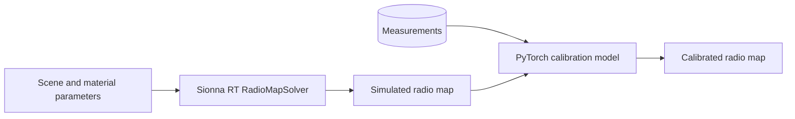

# radio-calibration

A research project that calibrates Sionna RT radio maps against measurements with PyTorch models.

## Contents

- [Overview](#overview)
- [Architecture](#architecture)
- [Getting started](#getting-started)
- [Configuration](#configuration)
- [Usage](#usage)
- [Development](#development)
- [Testing](#testing)
- [Related work](#related-work)
- [License](#license)
- [Acknowledgements](#acknowledgements)

## Overview

A radio map gives the channel gain at each cell of a grid around a transmitter.
[Sionna RT](https://nvlabs.github.io/sionna/rt/) computes radio maps with a ray tracer.
The result depends on the scene geometry, the material parameters, and the antenna patterns.
These inputs are approximate, so a simulated radio map differs from a measured radio map.

This project calibrates the simulated radio map with measurements.
The calibration method is not documented yet.

### Capabilities

The repository is at the setup stage. It contains these parts:

- A locked Python environment with PyTorch (CUDA 13.4), Sionna RT, Mitsuba, and Dr.Jit.
- Shared utilities for paths, figure style, random seeds, device selection, and notebook setup.
- Tests that run each main library, with Sionna RT on the CUDA backend.
- Four empty notebooks for data exploration, preprocessing, modeling, and evaluation.

_Calibration capabilities: not documented yet._

### Non-goals

_Not documented yet._

## Architecture

The diagram shows the intended data flow.
Only `src/utils` exists today. The other blocks are not implemented.



### Components

| Component | Responsibility | Location |
|---|---|---|
| Utilities | Paths, figure style, random seeds, device selection, notebook setup | [`src/utils/`](src/utils/) |
| Configuration | Hydra configuration files | [`conf/`](conf/) |
| Notebooks | Exploration, preprocessing, modeling, evaluation | [`notebooks/`](notebooks/) |
| Tests | Checks of the environment and of the utilities | [`tests/`](tests/) |

### External dependencies

| Dependency | Purpose | Criticality |
|---|---|---|
| [Sionna RT](https://github.com/NVlabs/sionna-rt) 2.2.0 | Ray tracer that computes radio maps | Critical |
| [Mitsuba](https://github.com/mitsuba-renderer/mitsuba3) 3.9.1 | Renderer below Sionna RT. Sionna RT pins this version. | Critical |
| [Dr.Jit](https://github.com/mitsuba-renderer/drjit) 1.5.0 | Just-in-time compiler below Mitsuba. Sionna RT pins this version. | Critical |
| [PyTorch](https://pytorch.org/) 2.15.0+cu134 | Calibration models and training | Critical |
| [Hydra](https://hydra.cc/) | Experiment configuration | Critical |

[`uv.lock`](uv.lock) records the exact version of each package.

## Getting started

### Prerequisites

| Requirement | Version | Notes |
|---|---|---|
| Python | 3.13 | `uv` installs it from [`.python-version`](.python-version). |
| [uv](https://docs.astral.sh/uv/) | >=0.11.30, <0.12 | The build backend `uv_build` sets this range. |
| NVIDIA GPU and driver | A driver that supports CUDA 13.4 | The environment was tested on Windows 11 with driver 610.88 and an RTX 3050 Ti (4 GB). |
| [Task](https://taskfile.dev/) | 3.52 or later | Optional. It gives short names to the commands below. |

### Install

```bash
git clone https://github.com/Wombat-Engineers/radio-calibration.git
cd radio-calibration
uv sync
uv run pre-commit install
```

`uv sync` installs PyTorch from the PyTorch package index for CUDA 13.4.
On Windows, PyPI has only the CPU build of PyTorch.

### Run

```bash
uv run jupyter lab
```

### Verify

```bash
uv run pytest
```

Expected last line of the output:

```
============================= 13 passed in 17.33s =============================
```

The time changes from run to run.
The tests for Mitsuba and Sionna RT use the CUDA variant `cuda_ad_mono_polarized`.
They fail if CUDA is not available. They do not use the CPU variant.

Dr.Jit can print `jitc_llvm_init(): LLVM API initialization failed` when LLVM is not installed.
The CUDA variants operate without LLVM.

## Configuration

[Hydra](https://hydra.cc/) reads the configuration from [`conf/config.yaml`](conf/config.yaml).

| Name | Type | Default | Description |
|---|---|---|---|
| `seed` | integer | `0` | Seed for the random generators. |

Precedence: command-line overrides, then `conf/config.yaml`.

The project reads no environment variables and holds no secrets.

## Usage

Call `setup_notebook` in the first cell of each notebook.
The function enables module autoreload, applies the figure style, and seeds the random generators.
It returns the device that tensors must use.

```python
from src.utils import DATA_DIR, setup_notebook

device = setup_notebook(seed=0)
print(device)  # cuda
print(DATA_DIR)  # <repository root>/data
```

_Calibration usage: not documented yet._

## Development

### Layout

```
radio-calibration/
├── conf/             Hydra configuration
├── notebooks/        Jupyter notebooks, numbered in the order of the workflow
├── src/              Python package (import name: src)
│   └── utils/        Paths, figure style, seeds, device, notebook setup
├── tests/            pytest tests
├── Taskfile.yml      Task definitions
├── pyproject.toml    Dependencies and tool configuration
└── uv.lock           Locked dependency versions
```

Git ignores `data/` and `outputs/`. Put data sets in `data/`. Hydra writes run results to `outputs/`.

### Standards

| | |
|---|---|
| **Style and lint** | [Ruff](https://docs.astral.sh/ruff/), enforced by pre-commit |
| **Notebooks** | `nbstripout` removes cell outputs before each commit |
| **Dependencies** | Change them with `uv add` or `uv remove`. Do not edit `uv.lock` by hand. |
| **Commits** | _Not documented yet._ |
| **Branching** | _Not documented yet._ |

If you add `torchvision` or `torchaudio`, add the package to `[tool.uv.sources]` in `pyproject.toml`.
Without that line, `uv` installs the CPU build from PyPI.

### Local loop

```bash
uv run ruff check .
uv run ruff format --check .
uv run pytest
```

`Taskfile.yml` gives the same commands short names. Run `task --list` to see them.

## Testing

| Tier | Scope | Command | Where it runs |
|---|---|---|---|
| Environment | Each main library runs: PyTorch on CUDA, Mitsuba and Sionna RT on CUDA, pandas with PyArrow, matplotlib, Hydra, scikit-learn, SciPy | `uv run pytest tests/test_environment.py` | Local machine with an NVIDIA GPU |
| Unit | `src/utils` | `uv run pytest tests/test_utils.py` | Local machine |

Run one test:

```bash
uv run pytest tests/test_environment.py::test_torch_autograd
```

Continuous integration and a coverage floor are not set.

## Related work

| Topic | Work |
|---|---|
| Ray tracer | Hoydis et al., [Sionna RT: Differentiable Ray Tracing for Radio Propagation Modeling](https://arxiv.org/abs/2303.11103), 2023. The paper shows that gradient descent can learn radio materials. |
| Ray tracer | Aït Aoudia et al., [Sionna RT: Technical Report](https://arxiv.org/abs/2504.21719), 2025. The report describes the path solver and the radio map solver. |
| Calibration by gradient descent | Hoydis et al., [Learning Radio Environments by Differentiable Ray Tracing](https://arxiv.org/abs/2311.18558), IEEE TMLCN, 2024. The method calibrates material properties, scattering, and antenna patterns against channel measurements. |
| Calibration with phase errors | Ruah et al., [Calibrating Wireless Ray Tracing for Digital Twinning using Local Phase Error Estimates](https://arxiv.org/abs/2312.12625), 2023. The method models the phase errors that geometry errors cause. |
| Calibration with signal strength | Chmela and Tripkovic, [Material Parameter Estimation for Sionna RT](https://doi.org/10.48436/ycw2e-xyw13), TU Wien, 2025. The code changes the material parameters to decrease the mean absolute error between simulated and measured signal strength. |
| Calibration with few measurements | An et al., [Taming Vision Priors for Data Efficient mmWave Channel Modeling](https://arxiv.org/abs/2603.13383), 2026. A vision-language model gives initial material properties. A few dozen channel measurements then calibrate the ray tracer. |
| Radio maps from deep learning | Li et al., [Geo2SigMap: High-Fidelity RF Signal Mapping Using Geographic Databases](https://arxiv.org/abs/2312.14303), 2023. A cascaded U-Net uses Sionna ray tracing and sparse measurements to predict signal maps. |
| Radio maps from deep learning | Saeizadeh et al., [AIRMap: AI-Generated Radio Maps for Wireless Digital Twins](https://arxiv.org/abs/2511.05522), 2025. A U-Net predicts path gain. Field measurements then calibrate the prediction. |
| Neural surrogates | Orekondy et al., [WiNeRT: Towards Neural Ray Tracing for Wireless Channel Modelling and Differentiable Simulations](https://iclr.cc/virtual/2023/poster/10694), ICLR 2023. |
| Neural surrogates | Hehn et al., [Differentiable and Learnable Wireless Simulation with Geometric Transformers](https://mlanthology.org/iclr/2025/hehn2025iclr-differentiable), ICLR 2025. |
| Review | Ruah et al., [How to Bridge the Sim-to-Real Gap in Digital Twin-Aided Telecommunication Networks](https://arxiv.org/abs/2507.07067), 2025. |

## License

MIT. See [LICENSE](LICENSE).

## Acknowledgements

This project uses [Sionna RT](https://github.com/NVlabs/sionna-rt), [Mitsuba 3](https://github.com/mitsuba-renderer/mitsuba3), and [Dr.Jit](https://github.com/mitsuba-renderer/drjit).
