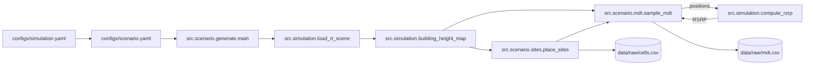
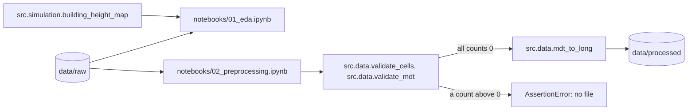

# radio-calibration

A research project that calibrates Sionna RT radio maps against measurements with PyTorch models.

## Contents

- [Overview](#overview)
- [Architecture](#architecture)
- [Getting started](#getting-started)
- [Configuration](#configuration)
- [Usage](#usage)
- [Development](#development)
- [Testing](#testing)
- [Related work](#related-work)
- [License](#license)
- [Acknowledgements](#acknowledgements)

## Overview

A radio map gives the channel gain at each cell of a grid around a transmitter.
[Sionna RT](https://nvlabs.github.io/sionna/rt/) computes radio maps with a ray tracer.
The result depends on the scene geometry, the material parameters, and the antenna patterns.
These inputs are approximate, so a simulated radio map differs from a measured radio map.

This project calibrates the simulated radio map with measurements.
The calibration method is not documented yet.

### Capabilities

The repository contains these parts:

- A locked Python environment with PyTorch (CUDA 13.4), Sionna RT, Mitsuba, and Dr.Jit.
- A scenario generator. It puts 3 sites with 3 cells each in a Sionna RT scene and writes
  synthetic MDT (minimization of drive tests) records. See [Scenario data](#scenario-data).
- Sionna RT functions that load a scene, measure the building heights, and calculate RSRP.
- Shared utilities for paths, figure style, random seeds, device selection, and notebook setup.
- Tests for each package, with Sionna RT on the CUDA backend.
- A notebook that examines the scenario data.
- A notebook for the exploratory data analysis (EDA) of the MDT records.
- Validation rules for `cells.csv` and `mdt.csv`, and a notebook that validates the data and
  writes it to `data/processed/` in the Parquet format. See
  [Exploratory analysis and preprocessing](#exploratory-analysis-and-preprocessing).
- Two empty notebooks for modeling and evaluation.

_Calibration capabilities: not documented yet._

### Non-goals

_Not documented yet._

## Architecture

The diagram shows the data flow of the scenario generator.
The calibration model is not implemented.



### Components

| Component | Responsibility | Location |
|---|---|---|
| Core | The `Cell` record, the format of `cells.csv`, and the column names of `mdt.csv` | [`src/core/`](src/core/) |
| Data | Validation rules of `cells.csv` and `mdt.csv`, and the long format of `data/processed/`. It has no Sionna RT import. | [`src/data/`](src/data/) |
| Simulation | All Sionna RT calls: scene load, building heights, RSRP from the path solver | [`src/simulation/`](src/simulation/) |
| Scenario | Site placement, traffic model, MDT records. It has no Sionna RT import. | [`src/scenario/`](src/scenario/) |
| Utilities | Paths, figure style, random seeds, device selection, notebook setup | [`src/utils/`](src/utils/) |
| Configuration | Hydra configuration files | [`configs/`](configs/) |
| Notebooks | Exploration, preprocessing, modeling, evaluation | [`notebooks/`](notebooks/) |
| Tests | Checks of the environment and of the utilities | [`tests/`](tests/) |

### External dependencies

| Dependency | Purpose | Criticality |
|---|---|---|
| [Sionna RT](https://github.com/NVlabs/sionna-rt) 2.2.0 | Ray tracer that computes radio maps | Critical |
| [Mitsuba](https://github.com/mitsuba-renderer/mitsuba3) 3.9.1 | Renderer below Sionna RT. Sionna RT pins this version. | Critical |
| [Dr.Jit](https://github.com/mitsuba-renderer/drjit) 1.5.0 | Just-in-time compiler below Mitsuba. Sionna RT pins this version. | Critical |
| [PyTorch](https://pytorch.org/) 2.15.0+cu134 | Calibration models and training | Critical |
| [Hydra](https://hydra.cc/) | Experiment configuration | Critical |

[`uv.lock`](uv.lock) records the exact version of each package.

## Getting started

### Prerequisites

| Requirement | Version | Notes |
|---|---|---|
| Python | 3.13 | `uv` installs it from [`.python-version`](.python-version). |
| [uv](https://docs.astral.sh/uv/) | >=0.11.30, <0.12 | The build backend `uv_build` sets this range. |
| NVIDIA GPU and driver | A driver that supports CUDA 13.4 | The environment was tested on Windows 11 with driver 610.88 and an RTX 3050 Ti (4 GB). |
| [Task](https://taskfile.dev/) | 3.52 or later | Optional. It gives short names to the commands below. |

### Install

```bash
git clone https://github.com/Wombat-Engineers/radio-calibration.git
cd radio-calibration
uv sync
uv run pre-commit install
```

`uv sync` installs PyTorch from the PyTorch package index for CUDA 13.4.
On Windows, PyPI has only the CPU build of PyTorch.

### Run

```bash
uv run jupyter lab
```

### Verify

```bash
uv run pytest
```

Expected last line of the output:

```
============================= 82 passed in 10.91s =============================
```

The time changes from run to run.
The tests for Mitsuba and Sionna RT use the CUDA variant `cuda_ad_mono_polarized`.
They fail if CUDA is not available. They do not use the CPU variant.

Dr.Jit can print `jitc_llvm_init(): LLVM API initialization failed` when LLVM is not installed.
The CUDA variants operate without LLVM.

## Configuration

[Hydra](https://hydra.cc/) reads the configuration from [`configs/`](configs/).

[`configs/config.yaml`](configs/config.yaml) is the root configuration:

| Name | Type | Default | Description |
|---|---|---|---|
| `seed` | integer | `0` | Seed for the random generators. |

The scenario generator uses two files. Each file has a comment for each value.

[`configs/simulation.yaml`](configs/simulation.yaml) is the configuration of Sionna RT.
These are the primary values:

| Name | Type | Default | Description |
|---|---|---|---|
| `scene.name` | string | `munich` | A scene that Sionna RT supplies, or a file `<name>.xml` in `data/external/scenes`. |
| `radio.frequency_hz` | number | `2.6e9` | Carrier frequency. |
| `radio.subcarrier_spacing_hz` | number | `30e3` | Bandwidth of the scene: one resource element. |
| `receiver` | mapping | 1 x 1 dipole, V | Planar array of the UE. |
| `solver.max_depth` | integer | `8` | Maximum number of interactions of a path. |
| `solver.samples_per_src` | integer | `1000000` | Number of rays for each source. |
| `solver.refraction` | boolean | `true` | With `true`, a signal can go through a wall. With `false`, an indoor position gets no signal. |
| `solver.diffraction` | boolean | `true` | Diffraction at building edges. |
| `rx_batch_size` | integer | `100` | Number of UE positions in one solver call. |

The `solver` block has all arguments of the Sionna RT `PathSolver`.
The code gives the block to the solver without a change.

[`configs/scenario.yaml`](configs/scenario.yaml) is the configuration of the test scenario.
It loads `simulation.yaml` into its key `simulation`.
These are the primary values:

| Name | Type | Default | Description |
|---|---|---|---|
| `seed` | integer | `0` | Seed for the random generators. |
| `grid.tile_size_m` | number | `5` | Side of a tile of the grid for the height map, in meters. |
| `grid.min_building_height_m` | number | `2` | A grid tile above this height is a building. |
| `antenna.power_rs` | number | `4.85` | Reference-signal power for each resource element, in dBm. |
| `antenna.transmitter` | mapping | 8 x 8 tr38901, cross | Planar array of each cell. The generator writes it to `cells.csv`. |
| `sites.isd_m` | number | `500` | Side of the triangle of sites, in meters. |
| `sites.mast_height_m` | number | `25` | Antenna height above the ground, in meters. |
| `sites.downtilt_deg` | number | `5` | Downtilt of each cell, in degrees. |
| `traffic.num_days` | integer | `1` | Number of days of MDT records. |
| `traffic.records_per_day` | number | `1000` | Mean number of MDT records in one day. |
| `ue_height.mean_m` | number | `1.5` | Mean UE height above the ground, in meters. |
| `ue_height.min_m`, `ue_height.max_m` | number | `0.5`, `2.5` | Limits of the UE height, in meters. |
| `measurement.rsrp_noise_mean_db` | number | `-5` | Mean of the RSRP measurement error, in dB. |
| `measurement.min_rsrp_dbm` | number | `-140` | A cell below this RSRP is not in the record. |

A value of `simulation.yaml` has the prefix `simulation.` in an override, for example
`simulation.solver.max_depth=5`.

Precedence: command-line overrides, then the YAML files.

The project reads no environment variables and holds no secrets.

## Usage

Call `setup_notebook` in the first cell of each notebook.
The function enables module autoreload, applies the figure style, and seeds the random generators.
It returns the device that tensors must use.

```python
from src.utils import DATA_DIR, setup_notebook

device = setup_notebook(seed=0)
print(device)  # cuda
print(DATA_DIR)  # <repository root>/data
```

### Scenario data

Generate the data for the experiments:

```bash
task scenario
```

Without Task, use `uv run python -m src.scenario`. Put Hydra overrides after the command,
for example `task scenario -- traffic.records_per_day=200 simulation.solver.max_depth=5`.
The command prints the time of the RSRP calculation and the total time.

The command writes three files to `data/raw/`. Each run replaces the files of the last run.

| File | Content |
|---|---|
| `cells.csv` | One row for each cell: `cell`, `site`, `x`, `y`, `z`, `azimuth_deg`, `downtilt_deg`, `power_rs_dbm`, and the array columns `num_rows`, `num_cols`, `vertical_spacing`, `horizontal_spacing`, `pattern`, `polarization`. |
| `mdt.csv` | One row for each MDT record: `timestamp`, `x`, `y`, `z`, and one `rsrp_<cell>` column for each cell. An empty value shows that the UE did not receive the cell. [`src/core/mdt.py`](src/core/mdt.py) sets the column names. |
| `scenario_config.yaml` | The configuration of the run. |

Positions are in meters, in the coordinate system of the scene.

The generator does these steps:

1. It measures the height of the scene on a grid. A grid tile above 2 m is a building.
2. It puts 3 sites at the corners of an equilateral triangle, 25 m above the ground.
   Each site has 3 cells. A corner in a building moves to the nearest outdoor grid tile.
3. It draws the number of records of each 15-minute slot from a Poisson distribution.
   Each record is independent of the other records.
4. It draws an outdoor position for each record. The probability increases with the
   building density. A residential part and a business part have different daily patterns,
   as in [Wang et al., 2015](https://arxiv.org/abs/1510.04026). Thus the positions change
   during the day.
5. It calculates the RSRP of each cell at each position with the Sionna RT path solver.
6. It adds a measurement error to the RSRP and a GNSS error to the position. It rounds the
   RSRP to 1 dB.
7. It samples a record again if the position is in a building or if no cell has a signal.

The notebook [`notebooks/00_scenario.ipynb`](notebooks/00_scenario.ipynb) examines the scene,
the cells, and each step of the MDT generation. Run all its cells with this command:

```bash
task notebook
```

Without Task, use
`uv run jupyter nbconvert --execute --to notebook --output-dir outputs/notebooks notebooks/00_scenario.ipynb`.
The copy with the outputs is in `outputs/notebooks/`.
The notebook also writes each figure as a PNG file with 300 dpi to `reports/figures/`.
Git ignores `reports/`.

To use real data, write `cells.csv` and `mdt.csv` with the same columns.
A converter from latitude and longitude to scene coordinates is not implemented.

### Exploratory analysis and preprocessing

Two notebooks read the files in `data/raw/`. Run `task scenario` first.



[`notebooks/01_eda.ipynb`](notebooks/01_eda.ipynb) is the exploratory data analysis. It has
10 sections: setup, load data, schema and dtypes, missingness, univariate distributions,
target analysis, group structure, relationships, temporal and spatial structure, and findings.
The target is the reported RSRP of one (record, cell) pair. The notebook loads the Sionna RT
scene for the building height map, thus it needs an NVIDIA GPU. It writes its figures with
the prefix `eda_` to `reports/figures/`.

```bash
task notebook -- notebooks/01_eda.ipynb
```

[`notebooks/02_preprocessing.ipynb`](notebooks/02_preprocessing.ipynb) validates the data and
writes it to `data/processed/`. It does not change a value. `validate_cells` and
`validate_mdt` count the rows that break each rule. If a count is not zero, the notebook stops
and writes no file. The notebook does not need a GPU.

```bash
task notebook -- notebooks/02_preprocessing.ipynb
```

| File | Content |
|---|---|
| `data/processed/mdt.parquet` | One row for each received (record, cell) pair: `record`, `timestamp`, `x`, `y`, `z`, `cell`, `rsrp_dbm`. `record` is the row index in `mdt.csv`, from 0. A missing RSRP gives no row. |
| `data/processed/cells.parquet` | The content of `cells.csv` |

_Calibration usage: not documented yet._

## Development

### Layout

```
radio-calibration/
├── configs/          Hydra configuration
├── notebooks/        Jupyter notebooks, numbered in the order of the workflow
├── src/              Python package (import name: src)
│   ├── core/         Cell record, cells.csv format, mdt.csv column names
│   ├── data/         Validation rules, long format of data/processed
│   ├── scenario/     Scenario generator: sites, traffic, MDT records
│   ├── simulation/   Sionna RT calls: scene, building heights, RSRP
│   └── utils/        Paths, figure style, seeds, device, notebook setup
├── tests/            pytest tests
├── Taskfile.yml      Task definitions
├── pyproject.toml    Dependencies and tool configuration
└── uv.lock           Locked dependency versions
```

Git ignores `data/` and `outputs/`. Put data sets in `data/`. Hydra writes run results to `outputs/`.

### Standards

| | |
|---|---|
| **Style and lint** | [Ruff](https://docs.astral.sh/ruff/), enforced by pre-commit |
| **Notebooks** | `nbstripout` removes cell outputs before each commit |
| **Dependencies** | Change them with `uv add` or `uv remove`. Do not edit `uv.lock` by hand. |
| **Commits** | _Not documented yet._ |
| **Branching** | _Not documented yet._ |

If you add `torchvision` or `torchaudio`, add the package to `[tool.uv.sources]` in `pyproject.toml`.
Without that line, `uv` installs the CPU build from PyPI.

### Local loop

```bash
uv run ruff check .
uv run ruff format --check .
uv run pytest
```

`Taskfile.yml` gives the same commands short names. Run `task --list` to see them.

## Testing

| Tier | Scope | Command | Where it runs |
|---|---|---|---|
| Environment | Each main library runs: PyTorch on CUDA, Mitsuba and Sionna RT on CUDA, pandas with PyArrow, matplotlib, Hydra, scikit-learn, SciPy | `uv run pytest tests/test_environment.py` | Local machine with an NVIDIA GPU |
| Unit | `src/utils` | `uv run pytest tests/test_utils.py` | Local machine |
| Unit | `src/core` | `uv run pytest tests/test_core.py` | Local machine |
| Unit | `src/data` | `uv run pytest tests/test_data.py` | Local machine |
| Unit | `src/simulation`, with the scene `simple_street_canyon` | `uv run pytest tests/test_simulation.py` | Local machine with an NVIDIA GPU |
| Unit | `src/scenario`. One test runs the full generator on a small scene. | `uv run pytest tests/test_scenario.py` | Local machine with an NVIDIA GPU |

Run one test:

```bash
uv run pytest tests/test_environment.py::test_torch_autograd
```

Continuous integration and a coverage floor are not set.

## Related work

| Topic | Work |
|---|---|
| Ray tracer | Hoydis et al., [Sionna RT: Differentiable Ray Tracing for Radio Propagation Modeling](https://arxiv.org/abs/2303.11103), 2023. The paper shows that gradient descent can learn radio materials. |
| Ray tracer | Aït Aoudia et al., [Sionna RT: Technical Report](https://arxiv.org/abs/2504.21719), 2025. The report describes the path solver and the radio map solver. |
| Calibration by gradient descent | Hoydis et al., [Learning Radio Environments by Differentiable Ray Tracing](https://arxiv.org/abs/2311.18558), IEEE TMLCN, 2024. The method calibrates material properties, scattering, and antenna patterns against channel measurements. |
| Calibration with phase errors | Ruah et al., [Calibrating Wireless Ray Tracing for Digital Twinning using Local Phase Error Estimates](https://arxiv.org/abs/2312.12625), 2023. The method models the phase errors that geometry errors cause. |
| Calibration with signal strength | Chmela and Tripkovic, [Material Parameter Estimation for Sionna RT](https://doi.org/10.48436/ycw2e-xyw13), TU Wien, 2025. The code changes the material parameters to decrease the mean absolute error between simulated and measured signal strength. |
| Calibration with few measurements | An et al., [Taming Vision Priors for Data Efficient mmWave Channel Modeling](https://arxiv.org/abs/2603.13383), 2026. A vision-language model gives initial material properties. A few dozen channel measurements then calibrate the ray tracer. |
| Radio maps from deep learning | Li et al., [Geo2SigMap: High-Fidelity RF Signal Mapping Using Geographic Databases](https://arxiv.org/abs/2312.14303), 2023. A cascaded U-Net uses Sionna ray tracing and sparse measurements to predict signal maps. |
| Radio maps from deep learning | Saeizadeh et al., [AIRMap: AI-Generated Radio Maps for Wireless Digital Twins](https://arxiv.org/abs/2511.05522), 2025. A U-Net predicts path gain. Field measurements then calibrate the prediction. |
| Neural surrogates | Orekondy et al., [WiNeRT: Towards Neural Ray Tracing for Wireless Channel Modelling and Differentiable Simulations](https://iclr.cc/virtual/2023/poster/10694), ICLR 2023. |
| Neural surrogates | Hehn et al., [Differentiable and Learnable Wireless Simulation with Geometric Transformers](https://mlanthology.org/iclr/2025/hehn2025iclr-differentiable), ICLR 2025. |
| Review | Ruah et al., [How to Bridge the Sim-to-Real Gap in Digital Twin-Aided Telecommunication Networks](https://arxiv.org/abs/2507.07067), 2025. |

## License

MIT. See [LICENSE](LICENSE).

## Acknowledgements

This project uses [Sionna RT](https://github.com/NVlabs/sionna-rt), [Mitsuba 3](https://github.com/mitsuba-renderer/mitsuba3), and [Dr.Jit](https://github.com/mitsuba-renderer/drjit).
