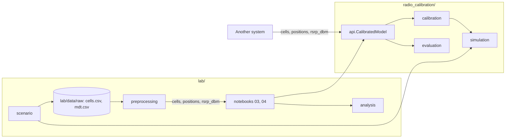
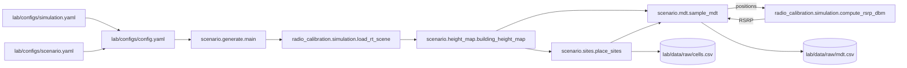
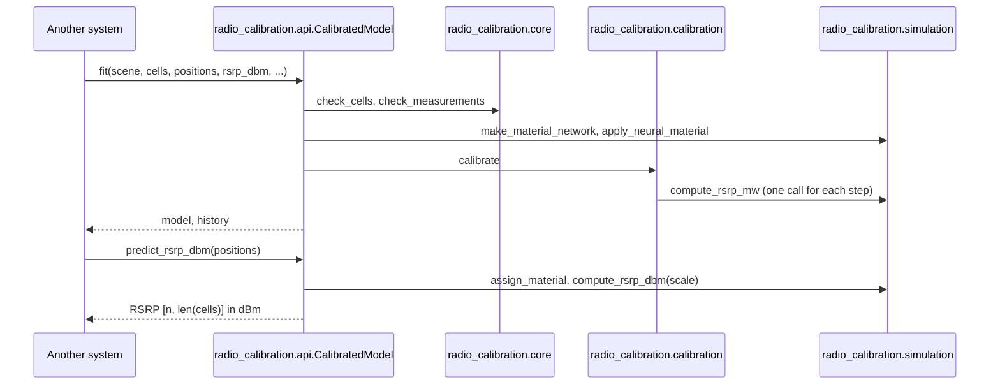
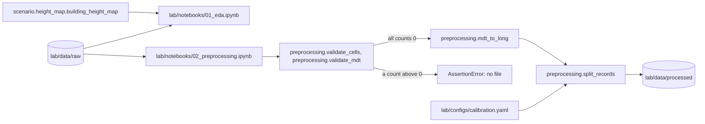
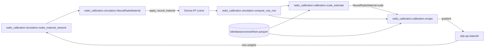

# radio-calibration

A research project that calibrates Sionna RT radio maps against measurements with a neural
radio material. The calibration package `radio_calibration` can go into another Python system.
The directory `lab/` holds the experiments that use it.

## Contents

- [Overview](#overview)
- [Architecture](#architecture)
- [Getting started](#getting-started)
- [Configuration](#configuration)
- [Usage](#usage)
- [Development](#development)
- [Testing](#testing)
- [Related work](#related-work)
- [License](#license)
- [Acknowledgements](#acknowledgements)

## Overview

A radio map gives the channel gain at each cell of a grid around a transmitter.
[Sionna RT](https://nvlabs.github.io/sionna/rt/) computes radio maps with a ray tracer.
The result depends on the scene geometry, the material parameters, and the antenna patterns.
These inputs are approximate, so a simulated radio map differs from a measured radio map.

This project calibrates the simulated radio map with measurements.
The calibration method is "Neural Materials" of Hoydis et al.,
[Learning Radio Environments by Differentiable Ray Tracing](https://arxiv.org/abs/2311.18558).
A neural network gives the material properties at each point of the scene. Gradient descent
changes the network until the simulated RSRP agrees with the measured RSRP.

### Capabilities

The repository contains these parts:

- A locked Python environment with Sionna RT, Mitsuba, Dr.Jit, and PyTorch (CUDA 13.4).
- The package `radio_calibration`. Another system can import it to calibrate a neural
  material, save it, load it, and predict the RSRP. See
  [Use from another system](#use-from-another-system).
- A scenario generator. It puts 3 sites with 3 cells each in a Sionna RT scene and writes
  synthetic MDT (minimization of drive tests) records. See [Scenario data](#scenario-data).
- Sionna RT functions that load a scene, measure the building heights, and calculate RSRP.
- A radio material for Sionna RT that gets its properties from a neural network
  (`NeuralRadioMaterial`). A training loop calibrates this network against the MDT records.
  See [Material calibration](#material-calibration).
- Shared utilities for paths, figure style, random seeds, device selection, and notebook setup.
- Tests for each package, with Sionna RT on the CUDA backend.
- A notebook that examines the scenario data.
- A notebook for the exploratory data analysis (EDA) of the MDT records.
- Validation rules for `cells.csv` and `mdt.csv`, and a notebook that validates the data.
  The notebook divides the records into train, validation, and test parts and writes them to
  `lab/data/processed/` in the Parquet format. See
  [Exploratory analysis and preprocessing](#exploratory-analysis-and-preprocessing).
- A notebook that calibrates the materials and compares the result with the ITU materials
  of the scene.
- A notebook that evaluates the calibration on the test records.

### Non-goals

_Not documented yet._

## Architecture

The repository holds two Python packages in one [uv workspace](https://docs.astral.sh/uv/concepts/projects/workspaces/):

| Package | Directory | Import names | Content |
|---|---|---|---|
| `radio-calibration` | [`radio_calibration/`](radio_calibration/) | `radio_calibration` | The code that another system needs: the simulation, the calibration, the error statistics, and the interface `radio_calibration.api`. It accepts processed data in a fixed format. |
| `lab` | [`lab/`](lab/) | `scenario`, `utils`, `preprocessing`, `analysis` | The experiments: the scenario generator, the raw file formats, the data preparation, the model comparison, the Hydra configuration, the notebooks, and the run scripts. |

`lab` uses `radio_calibration` in the same way as another system does. `radio_calibration`
never imports a module of `lab`. The wheel of `radio-calibration` contains only
`radio_calibration/`.



The next diagram shows the data flow of the scenario generator.
[Material calibration](#material-calibration) shows the data flow of the calibration.



### Components

| Component | Responsibility | Location |
|---|---|---|
| Interface | `CalibratedModel`: calibrate, save, load, predict the RSRP, and give the error of each pair | [`radio_calibration/api.py`](radio_calibration/api.py) |
| Core | The `Cell` record, the typed settings `SimulationSettings` and `CalibrationSettings`, and the checks of the input data | [`radio_calibration/core/`](radio_calibration/core/) |
| Simulation | All radio propagation calls of Sionna RT: scene load, RSRP from the path solver, and the neural radio material | [`radio_calibration/simulation/`](radio_calibration/simulation/) |
| Calibration | Loss, power scale, training loop, and file format of the calibration result. It uses Dr.Jit and has no Sionna RT import. | [`radio_calibration/calibration/`](radio_calibration/calibration/) |
| Evaluation | Error statistics of a calibrated model, also by group, the distance to the nearest record, and the resource use of a block of code (`ResourceMonitor`). It does no ray tracing. | [`radio_calibration/evaluation/`](radio_calibration/evaluation/) |
| Preprocessing | The formats of `cells.csv` and `mdt.csv`, their validation rules, the long format of `lab/data/processed/`, the division into parts, and the change to the arrays of `radio_calibration` | [`lab/preprocessing/`](lab/preprocessing/) |
| Analysis | The error of each (record, cell) pair as a table, and the bootstrap comparison of two models | [`lab/analysis/`](lab/analysis/) |
| Scenario | Height map, site placement, traffic model, MDT records | [`lab/scenario/`](lab/scenario/) |
| Utilities | Paths, configuration and typed settings, figure style, random seeds, device selection, notebook setup, steps and archive of a run | [`lab/utils/`](lab/utils/) |
| Scripts | Runs of the pipeline or of the notebooks, with one archive of the results | [`lab/scripts/`](lab/scripts/) |
| Configuration | Hydra configuration files | [`lab/configs/`](lab/configs/) |
| Notebooks | Exploration, preprocessing, material calibration, evaluation | [`lab/notebooks/`](lab/notebooks/) |
| Tests | One test file for each package of the two packages, and the checks of the environment | [`tests/`](tests/) |

### External dependencies

| Dependency | Purpose | Package | Criticality |
|---|---|---|---|
| [Sionna RT](https://github.com/NVlabs/sionna-rt) 2.2.0 | Ray tracer that computes radio maps | `radio-calibration` | Critical |
| [Mitsuba](https://github.com/mitsuba-renderer/mitsuba3) 3.9.1 | Renderer below Sionna RT. Sionna RT pins this version. | `radio-calibration` | Critical |
| [Dr.Jit](https://github.com/mitsuba-renderer/drjit) 1.5.0 | Just-in-time compiler below Mitsuba. Sionna RT pins this version. The calibration uses its automatic differentiation, its neural network module, and its AdamW optimizer. | `radio-calibration` | Critical |
| NumPy, pandas, SciPy | Arrays, the history table, and the nearest-record distance | `radio-calibration` | Critical |
| [psutil](https://github.com/giampaolo/psutil) | Memory and CPU use of the process for `ResourceMonitor` | `radio-calibration` | Low |
| [nvidia-ml-py](https://pypi.org/project/nvidia-ml-py/) | NVML bindings of NVIDIA: GPU memory and GPU use for `ResourceMonitor` | `radio-calibration` | Low |
| [PyTorch](https://pytorch.org/) 2.15.0+cu134 | Random seeds and device selection of the notebooks. The calibration does not use it. | `lab` | Low |
| [Hydra](https://hydra.cc/) | Experiment configuration | `lab` | Critical for `lab` |

[`uv.lock`](uv.lock) records the exact version of each package.

## Getting started

### Prerequisites

| Requirement | Version | Notes |
|---|---|---|
| Python | 3.13 | `uv` installs it from [`.python-version`](.python-version). |
| [uv](https://docs.astral.sh/uv/) | >=0.11.30, <0.12 | The build backend `uv_build` sets this range. |
| NVIDIA GPU and driver | A driver that supports CUDA 13.4 | The environment was tested on Windows 11 with driver 610.88 and an RTX 3050 Ti (4 GB). |
| [Task](https://taskfile.dev/) | 3.52 or later | Optional. It gives short names to the commands below. |

### Install

```bash
git clone https://github.com/Wombat-Engineers/radio-calibration.git
cd radio-calibration
uv sync
uv run pre-commit install
```

`uv sync` installs the two packages of the workspace, `radio-calibration` and `lab`, in
editable mode. It installs PyTorch for `lab` from the PyTorch package index for CUDA 13.4.
On Windows, PyPI has only the CPU build of PyTorch.

### Run

```bash
uv run jupyter lab
```

### Verify

```bash
uv run pytest
```

Expected last line of the output:

```
============================ 284 passed in 91.11s (0:01:31) ============================
```

The time changes from run to run.
The tests for Mitsuba and Sionna RT use the CUDA variant `cuda_ad_mono_polarized`.
They fail if CUDA is not available. They do not use the CPU variant.

Dr.Jit can print `jitc_llvm_init(): LLVM API initialization failed` when LLVM is not installed.
The CUDA variants operate without LLVM.

## Configuration

[Hydra](https://hydra.cc/) reads the configuration of `lab` from [`lab/configs/`](lab/configs/).
`radio_calibration` does not read a file: it gets `SimulationSettings` and
`CalibrationSettings` objects. `utils.simulation_settings` and `utils.calibration_settings`
make them from the configuration.

[`lab/configs/config.yaml`](lab/configs/config.yaml) is the root configuration. It loads each
other file of `lab/configs/` into its own key:

| Key | File | Content |
|---|---|---|
| `scenario` | [`lab/configs/scenario.yaml`](lab/configs/scenario.yaml) | The synthetic scenario |
| `simulation` | [`lab/configs/simulation.yaml`](lab/configs/simulation.yaml) | Sionna RT |
| `calibration` | [`lab/configs/calibration.yaml`](lab/configs/calibration.yaml) | The data split and the material calibration |
| `evaluation` | [`lab/configs/evaluation.yaml`](lab/configs/evaluation.yaml) | The evaluation of the calibration |

It also has these values:

| Name | Type | Default | Description |
|---|---|---|---|
| `seed` | integer | `42` | The only seed: scenario generator, path solver (`simulation.solver.seed` is `${seed}`), data split, network, and calibration. |
| `output.figures.dir` | string | `lab/reports/figures` | Directory of the figures (PNG) of the notebooks. A relative path starts at the repository root. |
| `output.tables.dir` | string | `lab/reports/tables` | Directory of the tables (CSV) of the notebooks. |
| `hydra.run.dir` | string | `lab/outputs/scenario/<date>/<time>` | Run directory of `task scenario`. A relative path starts at the working directory, the repository root. Hydra writes the configuration of the run (`.hydra/config.yaml`, `.hydra/overrides.yaml`) and the log there. |

`task scenario` and `utils.load_config` compose this file in the same way. Each file has a
comment for each value. No other file holds a copy of the configuration.

[`lab/configs/simulation.yaml`](lab/configs/simulation.yaml) is the configuration of Sionna RT.
These are the primary values:

| Name | Type | Default | Description |
|---|---|---|---|
| `scene.name` | string | `munich` | A scene that Sionna RT supplies, or a file `<name>.xml` in `lab/data/external/scenes`. The file has priority over a Sionna RT scene with the same name (`utils.scene_source`). |
| `radio.frequency_hz` | number | `2.6e9` | Carrier frequency. |
| `radio.subcarrier_spacing_hz` | number | `30e3` | Bandwidth of the scene: one resource element. |
| `receiver` | mapping | 1 x 1 dipole, V | Planar array of the UE. |
| `solver.max_depth` | integer | `5` | Maximum number of interactions of a path. |
| `solver.samples_per_src` | integer | `100000` | Number of rays for each source. |
| `solver.max_num_paths_per_src` | integer | `50000` | Size of the path buffer for each source. |
| `solver.refraction` | boolean | `true` | With `true`, a signal can go through a wall. With `false`, an indoor position gets no signal. |
| `solver.diffraction` | boolean | `true` | Diffraction at building edges. |
| `deterministic` | boolean | `false` | Argument of the `PathSolver` constructor. With `true`, the RSRP is bit-equal between runs, but Sionna RT 2.2.0 can give a NaN path when specular and diffuse reflections are both on. See [Reproducibility](#reproducibility). |
| `rx_batch_size` | integer | `10` | Number of UE positions in one solver call. |

The `solver` block has all arguments of a call of the Sionna RT `PathSolver`.
The code gives the block to the solver without a change.

[`lab/configs/scenario.yaml`](lab/configs/scenario.yaml) is the configuration of the test scenario.
These are the primary values:

| Name | Type | Default | Description |
|---|---|---|---|
| `grid.tile_size_m` | number | `5` | Side of a tile of the grid for the height map, in meters. |
| `grid.min_building_height_m` | number | `2` | A grid tile above this height is a building. |
| `antenna.power_rs` | number | `4.85` | Reference-signal power for each resource element, in dBm. |
| `antenna.transmitter` | mapping | 8 x 8 tr38901, cross | Planar array of each cell. The generator writes it to `cells.csv`. |
| `sites.isd_m` | number | `500` | Side of the triangle of sites, in meters. |
| `sites.mast_height_m` | number | `25` | Antenna height above the ground, in meters. |
| `sites.downtilt_deg` | number | `5` | Downtilt of each cell, in degrees. |
| `traffic.num_days` | integer | `1` | Number of days of MDT records. |
| `traffic.records_per_day` | number | `500` | Mean number of MDT records in one day. The value in use is small for a local smoke test. The comment `Recommended` gives the value for a full run. |
| `ue_height.mean_m` | number | `1.5` | Mean UE height above the ground, in meters. |
| `ue_height.min_m`, `ue_height.max_m` | number | `0.5`, `2.5` | Limits of the UE height, in meters. |
| `measurement.rsrp_noise_mean_db` | number | `-5` | Mean of the RSRP measurement error, in dB. |
| `measurement.min_rsrp_dbm` | number | `-140` | A cell below this RSRP is not in the record. |

An override names the key of the file, for example `scenario.sites.isd_m=600`,
`simulation.solver.max_depth=5`, or `seed=1`.

Precedence: command-line overrides, then the YAML files.

The project reads no environment variables and holds no secrets.

## Usage

### Use from another system

Another Python system imports `radio_calibration.api` in its own process. Install the
package from the repository, for example with `uv add <path to the repository>` or
`pip install <path to the repository>`. This installs only `radio_calibration` and its
dependencies, not `lab`. The system needs an NVIDIA GPU: the import sets the Mitsuba variant
`cuda_ad_mono_polarized` for the full process.

`radio_calibration` accepts processed data in one fixed format:

| Argument | Type | Content |
|---|---|---|
| `cells` | sequence of `Cell` | One record for each cell: position, azimuth, downtilt, reference-signal power, and antenna array. All cells have the same array. |
| `positions` | float array `[n, 3]` | UE positions in meters, in the coordinate system of the scene |
| `rsrp_dbm` | float array `[n, len(cells)]` | Measured RSRP in dBm. Row `i` is the record at `positions[i]`, column `j` is `cells[j]`. NaN shows that the record does not have the cell. |
| `simulation` | `SimulationSettings` | Frequency, UE antenna, and the arguments of the Sionna RT path solver |
| `calibration` | `CalibrationSettings` | Network size, optimizer, number of epochs, and batch size |

The checks at the boundary (`check_cells`, `check_measurements`) reject data in another
format. For example, an RSRP array with 3 columns for 2 cells gives:

```
ValueError: rsrp_dbm must have the shape (4, 2), but it is (4, 3).
```

Example:

```python
from pathlib import Path

import numpy as np

from radio_calibration.api import (
    CalibratedModel,
    CalibrationSettings,
    Cell,
    SimulationSettings,
    error_statistics,
    load_rt_scene,
)

cells = [
    Cell(
        name="s0c0",
        site=0,
        x=-60.0,
        y=0.0,
        z=10.0,
        azimuth_deg=0.0,
        downtilt_deg=5.0,
        power_rs_dbm=4.85,
        num_rows=2,
        num_cols=2,
        vertical_spacing=0.5,
        horizontal_spacing=0.5,
        pattern="tr38901",
        polarization="V",
    ),
    # ... one Cell for each cell
]
positions = np.array([[-30.0, 0.0, 1.5], [10.0, 0.0, 1.5]])
rsrp_dbm = np.array([[-84.0, np.nan], [-91.0, -97.0]])  # [n, len(cells)]
simulation = SimulationSettings(
    frequency_hz=2.6e9,
    subcarrier_spacing_hz=30e3,
    receiver={
        "num_rows": 1,
        "num_cols": 1,
        "vertical_spacing": 0.5,
        "horizontal_spacing": 0.5,
        "pattern": "dipole",
        "polarization": "V",
    },
    solver={"max_depth": 5, "samples_per_src": 100_000, "seed": 42},
    deterministic=False,
    rx_batch_size=10,
)
calibration = CalibrationSettings(
    encoding_octaves=4,
    hidden_layers=2,
    hidden_units=32,
    learning_rate=0.01,
    weight_decay=0.01,
    num_epochs=2,
    batch_size=8,
    validation_interval=1,
    scale_decay=0.9,
)

scene = load_rt_scene("munich")  # or Path("site.xml")
model, history = CalibratedModel.fit(
    scene, cells, positions, rsrp_dbm, (positions, rsrp_dbm), calibration, simulation, seed=42
)
model.save(Path("calibration.npz"))

model = CalibratedModel.load(scene, cells, Path("calibration.npz"), simulation)
predicted_dbm = model.predict_rsrp_dbm(positions)  # [n, len(cells)], NaN = no path
errors_db = model.errors_db(positions, rsrp_dbm)  # measured - predicted, in dB
print(error_statistics(rsrp_dbm, predicted_dbm, quantiles=[0.5, 0.9])["mae_db"])
```



The notebooks of `lab/` use the same interface: notebook 03 calls `CalibratedModel.fit`, and
notebook 04 calls `CalibratedModel.load` and `predict_rsrp_dbm`. `lab/preprocessing` changes
`cells.csv` and `mdt.csv` into the fixed format.

### Notebook setup

Call `setup_notebook` in the first cell of each notebook.
The function enables module autoreload, applies the figure style, seeds the random generators
with `seed`, and sets the output directories from `output`.
It returns the device that tensors must use.

```python
from utils import DATA_DIR, load_config, save_figure, save_table, setup_notebook

cfg = load_config()
device = setup_notebook(cfg)
print(device)  # cuda
print(DATA_DIR)  # <repository root>/lab/data
```

`save_figure(figure, "name")` writes `name.png` to `output.figures.dir`.
`save_table(table, "name")` writes `name.csv` to `output.tables.dir`, with the index. It accepts a
DataFrame or a styled DataFrame and returns its argument, thus it can wrap the last expression of
a cell: `save_table(frame.style.set_caption("Table 1. ..."), "name")`.

### Scenario data

Generate the data for the experiments:

```bash
task scenario
```

Without Task, use `uv run python -m scenario`. Put Hydra overrides after the command,
for example `task scenario -- scenario.traffic.records_per_day=200 simulation.solver.max_depth=5`.
The command prints the time of the RSRP calculation and the total time.

The command writes two files to `lab/data/raw/`. Each run replaces the files of the last run.
Hydra keeps the configuration and the log of each run in `lab/outputs/scenario/<date>/<time>/`.
The notebooks read `lab/configs/`, thus run `task scenario` again after a change of `lab/configs/`.

| File | Content |
|---|---|
| `cells.csv` | One row for each cell: `cell`, `site`, `x`, `y`, `z`, `azimuth_deg`, `downtilt_deg`, `power_rs_dbm`, and the array columns `num_rows`, `num_cols`, `vertical_spacing`, `horizontal_spacing`, `pattern`, `polarization`. |
| `mdt.csv` | One row for each MDT record: `timestamp`, `x`, `y`, `z`, and one `rsrp_<cell>` column for each cell. An empty value shows that the UE did not receive the cell. [`lab/preprocessing/mdt.py`](lab/preprocessing/mdt.py) sets the column names. |

Positions are in meters, in the coordinate system of the scene.

The generator does these steps:

1. It measures the height of the scene on a grid. A grid tile above 2 m is a building.
2. It puts 3 sites at the corners of an equilateral triangle, 25 m above the ground.
   Each site has 3 cells. A corner in a building moves to the nearest outdoor grid tile.
3. It draws the number of records of each 15-minute slot from a Poisson distribution.
   Each record is independent of the other records.
4. It draws an outdoor position for each record. The probability increases with the
   building density. A residential part and a business part have different daily patterns,
   as in [Wang et al., 2015](https://arxiv.org/abs/1510.04026). Thus the positions change
   during the day.
5. It calculates the RSRP of each cell at each position with the Sionna RT path solver.
6. It adds a measurement error to the RSRP and a GNSS error to the position. It rounds the
   RSRP to 1 dB.
7. It samples a record again if the position is in a building or if no cell has a signal.

The notebook [`lab/notebooks/00_scenario.ipynb`](lab/notebooks/00_scenario.ipynb) examines the scene,
the cells, and each step of the MDT generation. Run all its cells with this command:

```bash
task notebook
```

Without Task, use
`uv run jupyter nbconvert --execute --to notebook --output-dir lab/outputs/notebooks lab/notebooks/00_scenario.ipynb`.
The copy with the outputs is in `lab/outputs/notebooks/`.
The notebook also writes each figure as a PNG file with 300 dpi to `lab/reports/figures/`, and each
table as a CSV file to `lab/reports/tables/`. Git ignores `lab/reports/`.

To use real data, write `cells.csv` and `mdt.csv` with the same columns.
A converter from latitude and longitude to scene coordinates is not implemented.

### Exploratory analysis and preprocessing

Two notebooks read the files in `lab/data/raw/`. Run `task scenario` first.



[`lab/notebooks/01_eda.ipynb`](lab/notebooks/01_eda.ipynb) is the exploratory data analysis. It has
10 sections: setup, load data, schema and dtypes, missingness, univariate distributions,
target analysis, group structure, relationships, temporal and spatial structure, and findings.
The target is the reported RSRP of one (record, cell) pair. The notebook loads the Sionna RT
scene for the building height map, thus it needs an NVIDIA GPU. It writes its figures with
the prefix `eda_` to `lab/reports/figures/`.

```bash
task notebook -- lab/notebooks/01_eda.ipynb
```

[`lab/notebooks/02_preprocessing.ipynb`](lab/notebooks/02_preprocessing.ipynb) validates the data and
writes it to `lab/data/processed/`. It does not change a value. `validate_cells` and
`validate_mdt` count the rows that break each rule. If a count is not zero, the notebook stops
and writes no file. `split_records` then divides the records at random into the train,
validation, and test parts. `calibration.split.fractions` and `seed` set the division. All rows of one
record go to the same part. The notebook does not need a GPU.

```bash
task notebook -- lab/notebooks/02_preprocessing.ipynb
```

| File | Content |
|---|---|
| `lab/data/processed/train.parquet` | The train records. One row for each received (record, cell) pair: `record`, `timestamp`, `x`, `y`, `z`, `cell`, `rsrp_dbm`. `record` is the row index in `mdt.csv`, from 0. A missing RSRP gives no row. |
| `lab/data/processed/validation.parquet` | The validation records, in the same format |
| `lab/data/processed/test.parquet` | The test records, in the same format |
| `lab/data/processed/cells.parquet` | The content of `cells.csv` |

The notebook does not write `lab/data/processed/mdt.parquet`. A file with this name is from an
older version of the notebook.

### Material calibration

[`lab/notebooks/03_material_calibration.ipynb`](lab/notebooks/03_material_calibration.ipynb) explains
and runs the calibration. Run `task scenario` and `lab/notebooks/02_preprocessing.ipynb` first.
The notebook calls `CalibratedModel.fit` of `radio_calibration.api`, as another system does.
The diagram shows the functions that `fit` calls.



The parts of the method are these:

- **Material.** `NeuralRadioMaterial` is a subclass of the Sionna RT `RadioMaterial`. One
  multilayer perceptron gives the relative permittivity, the conductivity, the scattering
  coefficient, the XPD coefficient, and the thickness at the point of each ray interaction.
  All objects of the scene get the same material. The file
  [`radio_calibration/simulation/neural_material.py`](radio_calibration/simulation/neural_material.py) imports only
  Sionna RT, Mitsuba, Dr.Jit, and NumPy.
- **Loss.** The loss is the power term of the loss of the paper: the symmetric absolute
  percentage error between the measured RSRP and the simulated RSRP, in linear power. The
  MDT records have no delay spread, thus the delay spread term of the paper is not used.
- **Power scale.** The paper multiplies the measured power by a scale. Each step estimates
  the scale in closed form from the simulated RSRP of the step, and an exponential moving
  average smooths it. `NeuralRadioMaterial.scale` keeps the scale with the weights. Outside
  the gradient step, the scale divides the simulated power: `compute_rsrp_dbm` and
  `compute_rsrp_mw` apply it through their argument `scale`, and the measured RSRP has no
  scale. The two forms give the same loss.
- **Optimizer.** AdamW from Dr.Jit. The path solver runs with the loop mode `evaluated`,
  because Sionna RT gives no gradients in the loop mode `symbolic`.

[`lab/configs/calibration.yaml`](lab/configs/calibration.yaml) sets the network, the optimizer, the
number of epochs, and the batch size. Each epoch puts the train records in a new random
order and divides them into batches, thus each record is in one batch of each epoch. The Sionna RT configuration stays in
[`lab/configs/simulation.yaml`](lab/configs/simulation.yaml).

```bash
task notebook -- lab/notebooks/03_material_calibration.ipynb
```

The notebook writes these files to `lab/outputs/calibration/`:

| File | Content |
|---|---|
| `calibration.npz` | The weights of the network, the network structure, the normalization of the positions, and the power scale. `CalibratedModel.load` reads it and gives a model with its scale. |
| `history.csv` | The epoch, the loss, the power scale, the validation loss, and the run time (`step_seconds`) at each step |
| `resources.csv` | The samples of `ResourceMonitor` during the calibration: GPU memory and GPU use of the device, memory and CPU use of the process |

Each run gives different weights. [Reproducibility](#reproducibility) gives the cause.

The values in use in [`lab/configs/calibration.yaml`](lab/configs/calibration.yaml) and
[`lab/configs/simulation.yaml`](lab/configs/simulation.yaml) are small. They let the calibration run on
a GPU with 4 GB of memory. A comment `Recommended` beside a value gives the value for a GPU
with more memory. The recommended network size is that of the paper.

With the recommended values, one gradient step did not complete in 10 minutes on the 4 GB
development GPU. The largest part of the memory is the path buffer: Sionna RT allocates it for
`solver.max_num_paths_per_src` paths before it traces the rays.

The scenario generator uses the same solver values. After a change of a solver value, run
`task scenario` and `lab/notebooks/02_preprocessing.ipynb` again before the calibration. The tests
use a small scene and a small network.

### Evaluation

The notebook [`lab/notebooks/04_evaluation.ipynb`](lab/notebooks/04_evaluation.ipynb) measures the
error of the calibrated material on the test records. It compares three models:

| Model | Materials | Power scale |
|---|---|---|
| ITU materials | The materials of the scene file. The scenario generator used them, thus they give the lowest possible error. | Least squares on the train records |
| Initial neural material | The network before the calibration | Least squares on the train records |
| Calibrated neural material | The network of `lab/outputs/calibration/calibration.npz` | `NeuralRadioMaterial.scale` from the calibration |

The notebook gives these results:

- the bias, MAE, RMSE, standard deviation, quantiles of the absolute error, Pearson
  correlation, and SMAPE of each model on the train and the test records;
- the error by cell and by distance from the cell;
- the error by distance to the nearest train record, because a random division puts test
  records near train records ([Dempsey et al.](https://arxiv.org/abs/2411.17752));
- the difference of the MAE of two models, with a bootstrap interval over the records;
- the run time, the memory, and the CPU and GPU use of the simulation of each model.

[`lab/configs/evaluation.yaml`](lab/configs/evaluation.yaml) sets the quantiles, the number of
distance bands, and the bootstrap. `error_statistics`, `grouped_statistics`, and
`nearest_distance` are in [`radio_calibration/evaluation/`](radio_calibration/evaluation/) and take
the arrays of the fixed format. `pair_errors` and `paired_bootstrap` are in
[`lab/analysis/`](lab/analysis/). The notebook predicts the calibrated model with
`CalibratedModel.predict_rsrp_dbm`. Run the notebook after notebook 03:

```bash
task notebook -- lab/notebooks/04_evaluation.ipynb
```

### Reproducibility

The simulated RSRP finds the same paths in each run, but it is not the same bit for bit: it
changes by up to 2e-4 dB between runs, much less than the 1 dB resolution of a reported RSRP.
The cause is `simulation.deterministic: false`. The deterministic solver of Sionna RT 2.2.0 can
add an invalid path with a NaN amplitude when specular and diffuse reflections are both on, and
the NaN stops the calibration. The comment in `lab/configs/simulation.yaml` gives the numbers.

The calibration is not reproducible either. The
backward pass of the material network (Dr.Jit `nn.CoopVec` on CUDA) adds the gradients of
the weights with atomic float operations. The order of these additions changes from run to
run. The first step is the same in each run. After it, small differences grow during the
gradient steps, thus notebook 03 gives different weights, losses, power scales, and errors in
each run. The difference between two runs can be as large as the effect of the calibration.
No Dr.Jit flag changes this, and a fixed seed does not change it. Report the result of more
than one run with its spread.

### Runs on another machine

The values in use are small for the local GPU. Use two scripts to run the project with
larger values on a machine with a larger GPU, then analyze the results on the local machine.

| Command | Script | Steps |
|---|---|---|
| `task pipeline` | [`lab/scripts/run_pipeline.py`](lab/scripts/run_pipeline.py) | `python -m scenario`, then all notebooks in the order of their names |
| `task notebooks -- <notebook> ...` | [`lab/scripts/run_notebooks.py`](lab/scripts/run_notebooks.py) | The given notebooks, or all notebooks, on the data that exists |

Each script stops at the first step that fails. It always writes one archive
`lab/outputs/archives/<start time>.zip`, also after a failure. The archive has:

- `lab/data/raw/`, `lab/data/processed/`, `lab/outputs/calibration/`, `lab/outputs/notebooks/`, and the
  figure and table directories;
- `lab/configs/`: the YAML files of the run;
- `config.yaml`: the composed configuration that the notebooks read;
- `manifest.json`: the status (`ok` or `failed`), the time and the exit code of each step,
  the git commit, the package versions, and the GPU;
- for `task pipeline`, the Hydra record of the scenario run in `lab/outputs/scenario/`.

Do these steps:

1. On the other machine, clone the repository and run `uv sync`.
2. Change the values in `lab/configs/` to the values of the `Recommended` comments.
3. Run `task pipeline`. Without Task, use `uv run python lab/scripts/run_pipeline.py`.
4. Copy the archive to `lab/outputs/archives/` on the local machine, for example with `scp`.
5. On the local machine, run `task unpack -- lab/outputs/archives/<start time>.zip`.

`task unpack` extracts the archive to `lab/outputs/remote/<start time>/`. The local results do
not change.

## Development

### Layout

```
radio-calibration/
├── radio_calibration/    Package radio-calibration: the code for another system
│   ├── api.py            CalibratedModel: fit, save, load, predict_rsrp_dbm, errors_db
│   ├── core/             Cell record, typed settings, checks of the input data
│   ├── simulation/       Sionna RT calls: scene load, RSRP, neural material
│   ├── calibration/      Loss, power scale, training loop, result file
│   └── evaluation/       Error statistics, statistics by group, nearest-record distance, resource use
├── lab/                  Package lab: experiments and evaluation (pyproject.toml of its own)
│   ├── scenario/         Scenario generator: height map, sites, traffic, MDT records
│   ├── preprocessing/    cells.csv and mdt.csv formats, validation rules, parts, arrays
│   ├── analysis/         Error of each pair as a table, bootstrap comparison of two models
│   ├── utils/            Paths, configuration, figure style, seeds, notebook setup, run steps
│   ├── configs/          Hydra configuration
│   ├── notebooks/        Jupyter notebooks, numbered in the order of the workflow
│   ├── scripts/          Runs of the pipeline and of the notebooks, with an archive
│   ├── data/             Data sets (git ignores it)
│   ├── outputs/          Run results: calibration, executed notebooks, archives (git ignores it)
│   └── reports/          Figures and tables of the notebooks (git ignores it)
├── docs/                 Documentation (empty)
├── tests/                pytest tests of the two packages
├── Taskfile.yml          Task definitions
├── pyproject.toml        Package radio-calibration, the workspace, and the tool configuration
└── uv.lock               Locked dependency versions of the workspace
```

Put data sets in `lab/data/`. Hydra writes the run directories of `task scenario` to
`lab/outputs/scenario/`.

### Standards

| | |
|---|---|
| **Style and lint** | [Ruff](https://docs.astral.sh/ruff/), enforced by pre-commit |
| **Notebooks** | `nbstripout` removes cell outputs before each commit |
| **Dependencies** | Change them with `uv add` or `uv remove`. Use `uv add --package lab` for a dependency of the experiments only. Do not edit `uv.lock` by hand. |
| **Commits** | _Not documented yet._ |
| **Branching** | _Not documented yet._ |

If you add `torchvision` or `torchaudio`, add the package to `[tool.uv.sources]` in the root `pyproject.toml`.
Without that line, `uv` installs the CPU build from PyPI.

### Local loop

```bash
uv run ruff check .
uv run ruff format --check .
uv run pytest
```

`Taskfile.yml` gives the same commands short names. Run `task --list` to see them.

## Testing

| Tier | Scope | Command | Where it runs |
|---|---|---|---|
| Environment | Each main library runs: PyTorch on CUDA, Mitsuba and Sionna RT on CUDA, pandas with PyArrow, matplotlib, Hydra, scikit-learn, SciPy | `uv run pytest tests/test_environment.py` | Local machine with an NVIDIA GPU |
| Unit | `radio_calibration/core`, also a test that the import loads no pandas | `uv run pytest tests/test_core.py` | Local machine |
| Unit | `radio_calibration/simulation`, with the scene `simple_street_canyon`. Two tests check that `radio_calibration` imports no module of `lab` and has only the four subpackages. | `uv run pytest tests/test_simulation.py` | Local machine with an NVIDIA GPU |
| Unit | `radio_calibration/calibration`, with the scene `simple_street_canyon` and a small network | `uv run pytest tests/test_calibration.py` | Local machine with an NVIDIA GPU |
| Unit | `radio_calibration/evaluation` | `uv run pytest tests/test_evaluation.py` | Local machine with an NVIDIA GPU. The tests do no ray tracing, but `radio_calibration.calibration` loads the CUDA variant. |
| Unit | `radio_calibration/api`, with the full sequence of another system (`test_integration_flow`) | `uv run pytest tests/test_api.py` | Local machine with an NVIDIA GPU |
| Unit | `lab/utils` | `uv run pytest tests/test_utils.py` | Local machine |
| Unit | `lab/preprocessing` | `uv run pytest tests/test_preprocessing.py` | Local machine |
| Unit | `lab/analysis` | `uv run pytest tests/test_analysis.py` | Local machine with an NVIDIA GPU (same cause as `test_evaluation.py`) |
| Unit | `lab/scenario`. One test runs the full generator on a small scene. | `uv run pytest tests/test_scenario.py` | Local machine with an NVIDIA GPU |

Run one test:

```bash
uv run pytest tests/test_environment.py::test_torch_autograd
```

Continuous integration and a coverage floor are not set.

## Related work

| Topic | Work |
|---|---|
| Ray tracer | Hoydis et al., [Sionna RT: Differentiable Ray Tracing for Radio Propagation Modeling](https://arxiv.org/abs/2303.11103), 2023. The paper shows that gradient descent can learn radio materials. |
| Ray tracer | Aït Aoudia et al., [Sionna RT: Technical Report](https://arxiv.org/abs/2504.21719), 2025. The report describes the path solver and the radio map solver. |
| Calibration by gradient descent | Hoydis et al., [Learning Radio Environments by Differentiable Ray Tracing](https://arxiv.org/abs/2311.18558), IEEE TMLCN, 2024. The method calibrates material properties, scattering, and antenna patterns against channel measurements. |
| Evaluation of a calibration | Bakirtzis et al., [To Differentiate or To Deep Learn](https://arxiv.org/abs/2509.19337), 2025. The study compares a calibrated ray tracer with deep learning on operator RSRP. It reports RMSE, MAE, the correlation, and SMAPE. |
| Evaluation of a calibration | Sun et al., [campus 5G NR drive-test data set](https://doi.org/10.1016/j.dib.2026.113364), Data in Brief, 2026. The study tests a Sionna RT model on trajectories that the calibration did not use. It reports the bias, the standard deviation, and high percentiles of the error. |
| Spatial validation | Dempsey et al., [arXiv:2411.17752](https://arxiv.org/abs/2411.17752), 2024. A random division of spatial data can put information of the test data into the train data. |
| Calibration with phase errors | Ruah et al., [Calibrating Wireless Ray Tracing for Digital Twinning using Local Phase Error Estimates](https://arxiv.org/abs/2312.12625), 2023. The method models the phase errors that geometry errors cause. |
| Calibration with signal strength | Chmela and Tripkovic, [Material Parameter Estimation for Sionna RT](https://doi.org/10.48436/ycw2e-xyw13), TU Wien, 2025. The code changes the material parameters to decrease the mean absolute error between simulated and measured signal strength. |
| Calibration with few measurements | An et al., [Taming Vision Priors for Data Efficient mmWave Channel Modeling](https://arxiv.org/abs/2603.13383), 2026. A vision-language model gives initial material properties. A few dozen channel measurements then calibrate the ray tracer. |
| Radio maps from deep learning | Li et al., [Geo2SigMap: High-Fidelity RF Signal Mapping Using Geographic Databases](https://arxiv.org/abs/2312.14303), 2023. A cascaded U-Net uses Sionna ray tracing and sparse measurements to predict signal maps. |
| Radio maps from deep learning | Saeizadeh et al., [AIRMap: AI-Generated Radio Maps for Wireless Digital Twins](https://arxiv.org/abs/2511.05522), 2025. A U-Net predicts path gain. Field measurements then calibrate the prediction. |
| Neural surrogates | Orekondy et al., [WiNeRT: Towards Neural Ray Tracing for Wireless Channel Modelling and Differentiable Simulations](https://iclr.cc/virtual/2023/poster/10694), ICLR 2023. |
| Neural surrogates | Hehn et al., [Differentiable and Learnable Wireless Simulation with Geometric Transformers](https://mlanthology.org/iclr/2025/hehn2025iclr-differentiable), ICLR 2025. |
| Review | Ruah et al., [How to Bridge the Sim-to-Real Gap in Digital Twin-Aided Telecommunication Networks](https://arxiv.org/abs/2507.07067), 2025. |

## License

MIT. See [LICENSE](LICENSE).

## Acknowledgements

This project uses [Sionna RT](https://github.com/NVlabs/sionna-rt), [Mitsuba 3](https://github.com/mitsuba-renderer/mitsuba3), and [Dr.Jit](https://github.com/mitsuba-renderer/drjit).
